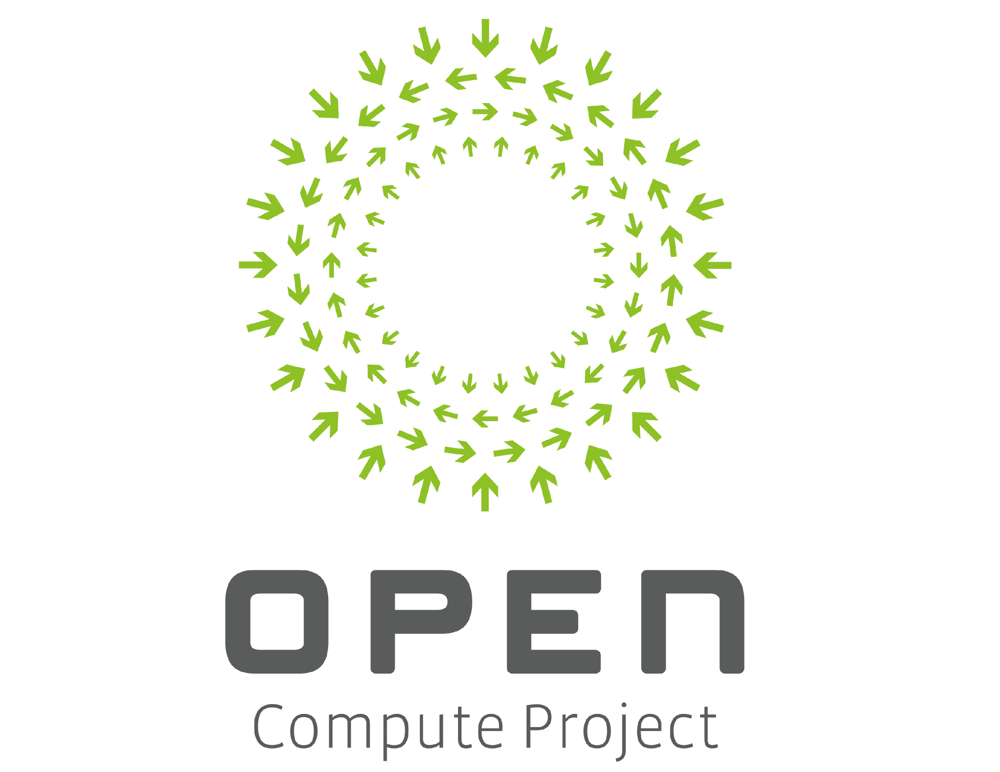

# Open Switch Platform Architecture: A Unified Network Switch Platform Reference Design

Revision 0.9.0

**Software Specification**

Effective Aug. 6, 2026

Author: Tao Ren, Tian Fang and Xu Wang, Meta  
Author: Ying Xie and Guohan Lu, Microsoft  
Author: Yiyuan Huang and Zhiping Yao, Alibaba

## Table of Contents

[1. Version History](#1-version-history)

[2. License](#2-license)

[2.1. Open Web Foundation (OWF) CLA](#21-open-web-foundation-owf-cla)

[2.2. Acknowledgements](#22-acknowledgements)

[3. Compliance with OCP Tenets](#3-compliance-with-ocp-tenets)

[3.1. Openness](#31-openness)

[3.2. Efficiency](#32-efficiency)

[3.3. Impact](#33-impact)

[3.4. Scale](#34-scale)

[3.5. Sustainability](#35-sustainability)

[4. Scope](#4-scope)

[5. Overview](#5-overview)

[6. Switch Platform Architecture](#6-switch-platform-architecture)

[6.1. BMC & Host Connectivity](#61-bmc-host-connectivity)

[6.2. Host Subsystem Architecture](#62-host-subsystem-architecture)

[7. System Power Management](#7-system-power-management)

[7.1. Power Supply Module](#71-power-supply-module)

[7.2. Power Sequencing and State Initialization](#72-power-sequencing-and-state-initialization)

[7.3. Power Control and Operational Logic](#73-power-control-and-operational-logic)

[8. Hardware Access](#8-hardware-access)

[8.1. Out-of-band Ethernet Access](#81-out-of-band-ethernet-access)

[8.1.1. Ethernet Connectivity and Port Requirements](#811-ethernet-connectivity-and-port-requirements)

[8.1.2. OOB_Switch Management](#812-oob_switch-management)

[8.1.3. Reference Designs](#813-reference-designs)

[8.2. Serial Console Access](#82-serial-console-access)

[8.3. Optical Module Access](#83-optical-module-access)

[8.3.1. Hardware Design Guidelines](#831-hardware-design-guidelines)

[8.3.2. I2C Controller Requirements](#832-i2c-controller-requirements)

[8.4. Optical Retimer Access](#84-optical-retimer-access)

[8.5. Front-panel LED Management](#85-front-panel-led-management)

[8.5.1. Requirements](#851-requirements)

[8.5.2. Operational Logic](#852-operational-logic)

[8.6. USB Topology](#86-usb-topology)

[9. Hardware Inventory Management](#9-hardware-inventory-management)

[9.1. Concept Overview](#91-concept-overview)

[9.2. APE Hierarchical Topology](#92-ape-hierarchical-topology)

[9.3. APE Identification (IDPROM Specification)](#93-ape-identification-idprom-specification)

[9.3.1. Root APE IDPROM](#931-root-ape-idprom)

[9.3.2. Platform Identifier IDPROM](#932-platform-identifier-idprom)

[9.3.3. APE IDPROM Requirements](#933-ape-idprom-requirements)

[9.4. Switch Platform Identification](#94-switch-platform-identification)

[9.5. Platform Device Enumeration](#95-platform-device-enumeration)

[9.5.1. Enumeration Methodology](#951-enumeration-methodology)

[9.5.2. Dynamic Event Handling](#952-dynamic-event-handling)

[9.6. Case Study: Minipack3 Device Enumeration](#96-case-study-minipack3-device-enumeration)

[10. Environment Monitoring and Control](#10-environment-monitoring-and-control)

[10.1. Hardware Sensors Monitoring](#101-hardware-sensors-monitoring)

[10.1.1. Sensor Design Guidelines](#1011-sensor-design-guidelines)

[10.2. Thermal Management](#102-thermal-management)

[10.2.1. Fan Management](#1021-fan-management)

[10.2.2. ASIC Overheat Protection](#1022-asic-overheat-protection)

[10.3. Liquid Leak Detection](#103-liquid-leak-detection)

[11. Firmware Maintenance and Recovery](#11-firmware-maintenance-and-recovery)

[11.1. Firmware Upgrade Basic Requirements](#111-firmware-upgrade-basic-requirements)

[11.2. Firmware Recovery](#112-firmware-recovery)

[11.3. Case Study: Minipack3 Firmware Upgrade Strategy](#113-case-study-minipack3-firmware-upgrade-strategy)

[12. Security](#12-security)

[13. Debuggability](#13-debuggability)

[13.1. IPMI](#131-ipmi)

[13.2. Processor & System Error Reporting](#132-processor-system-error-reporting)

[13.3. Hardware Fault Logger](#133-hardware-fault-logger)

[14. Host Software Reference Design](#14-host-software-reference-design)

[14.1. Device Driver Design](#141-device-driver-design)

[14.1.1. FPGA I/O Controller Discovery](#1411-fpga-io-controller-discovery)

[14.1.2. IOB FPGA Driver Example](#1412-iob-fpga-driver-example)

[14.1.3. User/Kernel ABI](#1413-userkernel-abi)

[14.2. Platform Device Discovery](#142-platform-device-discovery)

[14.3. Platform Services Implementation Principles](#143-platform-services-implementation-principles)

[Appendix A: I2C Design Best Practices](#appendix-a-i2c-design-best-practices)

[Appendix B: SPI Design Best Practices](#appendix-b-spi-design-best-practices)

[Appendix C: I/O Bridge FPGA Best Practices](#appendix-c-io-bridge-fpga-best-practices)

[Appendix D: Customer Consultation Checklist](#appendix-d-customer-consultation-checklist)

[Appendix E: Glossary](#appendix-e-glossary)

# 1. Version History

| Date     | Version # | Author                                                                                                  | Description     |
|----------|-----------|---------------------------------------------------------------------------------------------------------|-----------------|
| 8/6/2026 | 0.9.0     | Tao Ren, Tian Fang and Xu Wang, Meta Ying Xie and Guohan Lu, Microsoft Yiyuan Huang and Zhiping Yao, Alibaba | Initial release |
|          |           |                                                                                                           |                 |
|          |           |                                                                                                           |                 |

# 2. License

THE UPDATED DEFAULT CONTRIBUTOR LICENSE AGREEMENT (CLA) IS OWFa 0.9. PLEASE VERIFY THE CORRECT CLA/FSA IS USED AND EXECUTED FOR THIS CONTRIBUTION.

## 2.1. Open Web Foundation (OWF) CLA

Contributions to this Specification are made under the terms and conditions set forth in Modified Open Web Foundation Agreement 0.9 (OWFa 0.9). (As of October 16, 2024) ("Contribution License") by:

-   **Meta**
-   **Microsoft**
-   **Alibaba**

Usage of this Specification is governed by the terms and conditions set forth in **Modified OWFa 0.9 Final Specification Agreement (FSA) (As of October 16, 2024) ("Specification License").**

You can review the applicable Specification License(s) referenced above by the contributors to this Specification on the OCP website at <https://www.opencompute.org/contributions/templates-agreements>.

For actual executed copies of either agreement, please contact OCP directly.

**Notes**:

1.  The above license does not apply to the Appendix or Appendices. The information in the Appendix or Appendices is for reference only and non-normative in nature.

NOTWITHSTANDING THE FOREGOING LICENSES, THIS SPECIFICATION IS PROVIDED BY OCP "AS IS" AND OCP EXPRESSLY DISCLAIMS ANY WARRANTIES (EXPRESS, IMPLIED, OR OTHERWISE), INCLUDING IMPLIED WARRANTIES OF MERCHANTABILITY, NON-INFRINGEMENT, FITNESS FOR A PARTICULAR PURPOSE, OR TITLE, RELATED TO THE SPECIFICATION. NOTICE IS HEREBY GIVEN, THAT OTHER RIGHTS NOT GRANTED AS SET FORTH ABOVE, INCLUDING WITHOUT LIMITATION, RIGHTS OF THIRD PARTIES WHO DID NOT EXECUTE THE ABOVE LICENSES, MAY BE IMPLICATED BY THE IMPLEMENTATION OF OR COMPLIANCE WITH THIS SPECIFICATION. OCP IS NOT RESPONSIBLE FOR IDENTIFYING RIGHTS FOR WHICH A LICENSE MAY BE REQUIRED IN ORDER TO IMPLEMENT THIS SPECIFICATION. THE ENTIRE RISK AS TO IMPLEMENTING OR OTHERWISE USING THE SPECIFICATION IS ASSUMED BY YOU. IN NO EVENT WILL OCP BE LIABLE TO YOU FOR ANY MONETARY DAMAGES WITH RESPECT TO ANY CLAIMS RELATED TO, OR ARISING OUT OF YOUR USE OF THIS SPECIFICATION, INCLUDING BUT NOT LIMITED TO ANY LIABILITY FOR LOST PROFITS OR ANY CONSEQUENTIAL, INCIDENTAL, INDIRECT, SPECIAL OR PUNITIVE DAMAGES OF ANY CHARACTER FROM ANY CAUSES OF ACTION OF ANY KIND WITH RESPECT TO THIS SPECIFICATION, WHETHER BASED ON BREACH OF CONTRACT, TORT (INCLUDING NEGLIGENCE), OR OTHERWISE, AND EVEN IF OCP HAS BEEN ADVISED OF THE POSSIBILITY OF SUCH DAMAGE.

## 2.2. Acknowledgements

The OCP Open Switch Platform Architecture (OSPA) Working Group would like to thank the following organizations and individuals for their valuable feedback and contributions to this specification:

-   **Accton:** Susan Tsao, Brandon Chuang
-   **Arista:** Dean Kalla
-   **Celestica:** Chun Dong, Krishnakumar Gowravaram
-   **Cisco:** Scott Paulsen
-   **Data Touch Innovative Technologies:** Kevin Yao
-   **Micas:** Tim Zhou, Simon Zhao, William Liu, Eric Xiao, Elen Chen, Ivan Kong, Grant Lai, Gaia Gao, Scott Fan
-   **Nexthop:** Ravindra Rama, Michael Chan, Ryan Torres, Gordon Martinez-Piedra, Roger Liao
-   **Nvidia:** Mana Palai
-   **Wistron:** Kevin Chen

------------------------------------------------------------------------

# 3. Compliance with OCP Tenets

This Specification complies with all five OCP tenets, as described below.

A full explanation of the OCP core tenets can be seen [here](https://146a55aca6f00848c565-a7635525d40ac1c70300198708936b4e.ssl.cf1.rackcdn.com/images/bf648bb75091907147e76846cad590f402660d2e.pdf).

## 3.1. Openness

-   Publishes a vendor-neutral, open reference architecture for the switch platform software layer.
-   Releases open-source reference implementations, including the I/O Bridge FPGA controller drivers and the platform services stack, with proven deployment across over 10 production switch platforms.
-   Prioritizes components with upstream mainline Linux driver support to ensure platform enablement is open and vendor-agnostic.

## 3.2. Efficiency

-   Eliminates redundant platform software development across vendor platforms.
-   Enables platform onboarding in under one day via a configuration-driven design.
-   Reduces long-term maintenance and troubleshooting costs through a unified hardware/software architecture.

## 3.3. Impact

-   Standardizes foundational areas like hardware inventory, power sequencing, and firmware updates industry-wide.
-   Lowers the barrier to entry for new hardware designs by aligning them with established software stacks.
-   Accelerates platform onboarding and hardens out-of-band management practices.

## 3.4. Scale

-   Establishes a predictable, hierarchical topology for inventory management that handles growing device counts seamlessly.
-   Provides repeatable debuggability and field-upgrade strategies that deploy consistently across large data center fleets.
-   Simplifies mass production and maintenance through structured hardware-access rules.

## 3.5. Sustainability

-   Promotes hardware reusability and lifecycle extension, reducing e-waste from redundant custom platform development.
-   Streamlines operational maintenance to reduce long-term infrastructure and resource consumption.

------------------------------------------------------------------------

# 4. Scope

This specification is limited to the switch platform management layer. Although software-centric, it includes necessary hardware context for seamless integration, while excluding pure hardware design details.

Data and control plane operations—such as routing protocols and forwarding management—are outside the scope of this document.

# 5. Overview

The proliferation of switch platforms across the industry has led to fragmented and redundant platform software development efforts. This specification addresses the challenge by defining a unified reference architecture for the switch platform layer, aimed at simplifying and accelerating the platform onboarding process.

The following sections outline the architectural framework:

-   **Switch Platform Architecture:** Outlines the partitioning between the BMC and Host subsystems.
-   **System Power Management:** Details the initial power sequencing and BMC/Host power management capabilities.
-   **Hardware Access:** Defines mandatory out-of-band management and connectivity requirements.
-   **Hardware Inventory Management:** Establishes hierarchical topology and identification standards for inventory management.
-   **Environment Monitoring and Control:** Specifies requirements for sensor telemetry and thermal health governance.
-   **Firmware Maintenance:** Outlines strategies for Field Programmable Device Firmware Upgrade.
-   **Security:** Describes foundational security requirements.
-   **Debuggability**: Defines best practices to improve switch debuggability.
-   **Host Software Reference Design**: Describes a configuration-driven approach for implementing platform software.

Codifying these architectural guidelines accelerates platform onboarding by promoting reusable hardware designs and leveraging established software stacks; simultaneously, the resulting standardized platform design minimizes long-term maintenance and operational costs.

# 6. Switch Platform Architecture

Modern network switch architectures feature two primary processing domains: the **BMC** (Baseboard Management Controller) subsystem and the **Host** subsystem. Platform management responsibilities are typically distributed according to one of two primary architectural models:

1.  **OOB-Native Model:** In this paradigm, all platform management services—including fan control, sensor monitoring, leak detection, inventory management, and firmware upgrades—are centralized on the BMC. Consequently, the Host subsystem focuses exclusively on the data plane, operating without awareness of platform-level management tasks.
2.  **In-Host Model:** Here, the BMC serves as a supervisor restricted to essential, low-level functions such as power management, Host bring-up, leak protection and troubleshooting. All remaining platform management services—such as sensor management, fan control, inventory management, and firmware maintenance—are executed within the Host subsystem.

This specification focuses exclusively on the **In-Host Model**. By running the platform software on the Host, the architecture leverages the Host's computational resources and integrates platform management directly into the primary software ecosystem, improving maintainability and feature velocity.

### 6.1. BMC & Host Connectivity

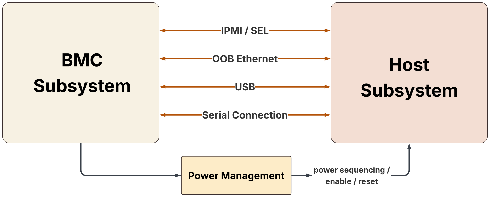

Reliable communication between the BMC and Host subsystems is essential for system coordination. The platform must implement the following interfaces:

-   **Out-of-Band (OOB) Ethernet:** Serves as the primary management network, providing bidirectional access to both BMC and Host subsystems independent of the data plane.
-   **Serial Console:** Provides a dedicated, physical serial connection to both subsystems, essential for low-level debugging and recovery.
-   **IPMI:** Facilitates structured, inter-processor communication for standardized System Event Logs (SEL) between the BMC and Host management controllers.
-   **USB:** Provides a redundant diagnostic and recovery path, utilizing serial or Ethernet-over-USB communication between the Host and BMC.
-   **Power Management Interconnects:** Utilizes dedicated hardware paths (e.g., GPIOs, CPLD signals) enabling the BMC to manage Host power states and reset lines. This architecture grants the BMC the authority to power cycle the Host subsystem specifically, as well as the capability to power cycle the entire switch platform independently of the Host OS state.

### 6.2. Host Subsystem Architecture

The following logical diagram provides a detailed representation of the platform device topology within the Host subsystem:

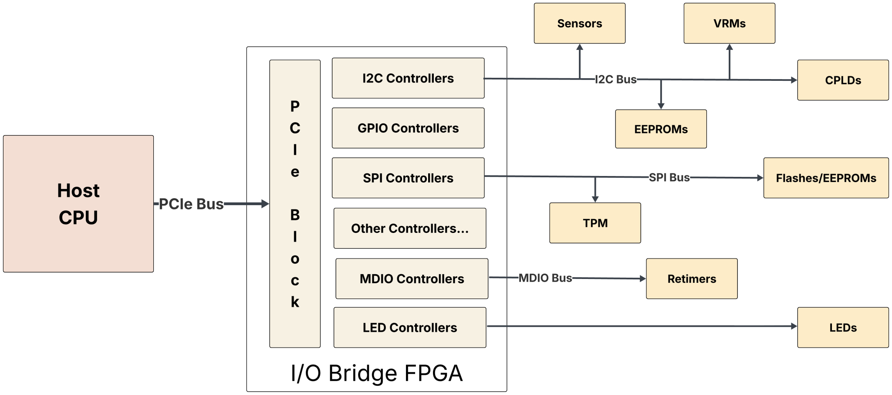

Central to this architecture is the I/O Bridge (IOB) FPGA(s), which serves as the critical aggregation and translation layer between the Host CPU and platform peripherals. Depending on the required I/O fan-out, a platform may implement this layer as a single IOB FPGA or as multiple IOB FPGAs. The IOB FPGA(s) acts as the primary interface, exposing a suite of specialized I/O controllers—including I2C, GPIO, SPI, MDIO, etc — that enable the Host CPU to manage client devices such as sensors, fans, CPLDs, flashes, and EEPROMs.

To optimize performance and reliability, each IOB FPGA must connect to the Host CPU via a high-speed PCIe interface, facilitating memory-mapped software access. This configuration ensures that platform software can interact with these peripherals with low latency, providing a robust and scalable framework for managing complex hardware topologies.

# 7. System Power Management

This section defines the architectural requirements for the switch's power delivery and management infrastructure, including specifications for power supply units, autonomous power sequencing, and BMC/Host power management capabilities.

## 7.1. Power Supply Module

Power supply modules must operate as intelligent, observable, and software-manageable components. The following specifications detail the architectural and operational requirements necessary for integration within the platform.

-   **Input Types:** Power supplies must accommodate AC or DC inputs, or both, aligned with client’s specific rack and data center infrastructure requirements.
-   **Form Factor:** Power Supply modules may be implemented as either integrated power brick modules or Field Replaceable Units (FRU).
-   **FRU Design:** Power Supply Units (PSUs) configured as Field Replaceable Units (FRUs) must feature tool-less, hot-swappable mechanisms with secure latching. PSU Fan management should be handled entirely by the FRU's internal firmware to decouple PSU’s thermal control from the platform software layer. Additionally, each FRU must provide the following signals for software management:
    -   **Presence:** Connected to the Host GPIO controller (or CPLD) for real-time detection of module insertion and removal events.
    -   **Power_Good:** Connected to the Host GPIO controller (or CPLD) for real-time monitoring of power output status and failure events.
    -   **PSU_PSON:** Connected to the BMC GPIO/CPLD to allow the BMC to enable or disable the PSU.
-   **Monitoring and Telemetry:** All power supply modules are required to implement a PMBus-compliant interface. This interface must provide platform software with real-time access to input/output voltage, current, power, temperature, and fan speed data.
-   **Reliability and Safety:** AC configurations must support N+1 redundancy or better, with active current sharing. All modules (AC/DC) must integrate autonomous, hardware-level shutdown circuits to protect the system from fault conditions—such as overcurrent, overvoltage, and thermal runaway—independent of software intervention. In the event of an over-temperature condition, output must be automatically restored once the condition clears (OTP), while overcurrent (OCP) and overvoltage (OVP) faults must latch off, requiring a manual power-cycle for recovery.
-   **Firmware Lifecycle:** To facilitate ongoing maintenance, all FRU modules must support remote, field-upgradable firmware, preferably delivered via the PMBus interface.

## 7.2. Power Sequencing and State Initialization

Upon initial system startup or following a switch-level power cycle, below hardware components shall be initialized to their designated states autonomously without software intervention:

-   **BMC Subsystem:** The BMC subsystem shall be powered on automatically.
-   **Host Subsystem:** By default, the Host (including CPU, ASICs, and Optics) must remain powered off or in reset mode until the BMC, or the Host Bringup watchdog, activates it.
-   **Host Bringup Watchdog:** While the BMC software typically initiates the Host power-on sequence, a hardware watchdog is required as a fallback to ensure Host availability in the event of a BMC failure. This watchdog will automatically trigger Host power-on following a 5-minute default timeout. A configurable timeout, and retaining that configuration in non-volatile storage is nice to have so the configured Host bring-up behavior persists across power cycles. The BMC software is responsible for disabling the watchdog once Host power-good is asserted. If the Host is already powered on when the watchdog timer expires, the watchdog must not alter the existing power state.
-   **First-time Activation:** When the Host subsystem is powered on for the first time by BMC software:
    -   The switching ASIC(s) shall be brought out of reset automatically without Host software interaction.
    -   Optics modules shall remain in reset mode until brought out of reset by the optics management software running in Host.
    -   The hardware design must ensure the ASIC can always be enumerated on the PCIe bus, and the corresponding IO/memory/interrupt resources are allocated properly across Host CPU resets, without software interaction.

## 7.3. Power Control and Operational Logic

This section defines the persistent power management capabilities required for the system:

-   An always-on CPLD or auxiliary-domain power sequencer must be implemented, providing a "cycle with automatic restore after N seconds" primitive accessible to both the BMC and the Host.

**BMC Power Management Capabilities:**

-   The BMC must be capable of power cycling the entire switch (including both BMC and Host subsystems).
-   The BMC must be capable of power cycling the Host CPU together with the data plane, including the switch ASIC and the transceivers.
-   The BMC must be capable of power cycling the Host CPU only, leaving the data plane powered.
-   The BMC must independently manage Host power states and reset signals.
-   BMC-initiated resets must be performed seamlessly, without disrupting active Host operations.

**Host Power Management Capabilities:**

-   The system design must enable Host software to:
    -   Perform ASIC chip-level and PCIe-level resets where applicable.
    -   Manage optics module power and reset states, including low-power mode transitions.
    -   Reset the BMC subsystem for recovery purposes.
    -   Initiate a full-system power cycle.
    -   Initiate a Host CPU reset, which does not interfere with ongoing BMC operations.
-   Once the ASIC has exited reset, its forwarding engine must remain unaffected by Host CPU resets. While a Host CPU reset may trigger an ASIC PCIe-level reset if necessary, it must not induce an ASIC chip-level reset.

# 8. Hardware Access

This section defines the mandatory connectivity and interface standards required for low-level hardware control and out-of-band management.

## 8.1. Out-of-band Ethernet Access

### 8.1.1. Ethernet Connectivity and Port Requirements

-   **Front-Panel Ports:** The design must incorporate two management ports. Two potential configurations are outlined below, and switch manufacturers should consult with the customer to determine the preferred implementation.
    -   2x1G RJ45 ports
    -   1x1G RJ45 port + 1x10G SFP+ port
-   **Architecture:** Connectivity between the BMC, Host, and front-panel ports shall be facilitated by an unmanaged/EEPROM-configured *oob_switch* (e.g., Marvell 88E6321). The use of NC-SI (Network Controller Sideband Interface) is explicitly discouraged.
-   **Operating Modes:**
    -   Simultaneous traffic concurrency must be supported on both management ports.

### 8.1.2. OOB_Switch Management

-   **EEPROM Configuration:** The *oob_switch* configuration must be factory-programmed into a dedicated local EEPROM.
-   **Initialization:** After a system-level power cycle or an explicit OOB_switch reset, the switch must autonomously load and apply its configuration from the EEPROM.
-   **Operational Readiness:** Once the EEPROM configuration is loaded, all physical ports (BMC, Host, and front-panel) must be fully functional without needing additional software intervention.
-   **Resilience:** The OOB switch's operational state must persist independently of any BMC or Host subsystem resets.
-   **Field Programmability:** For ease of service, the configuration EEPROM must allow in-field programming via an I2C or SPI interface connected to the Host-side controller.
-   **Hardware Reset:** To ensure robust recovery, the OOB switch's reset pin must be connected to a Host-managed GPIO line, providing manual, out-of-band reset functionality.
-   **MDIO Interface:** The *oob_switch* MDIO interface must connect directly to the BMC's designated MDIO controller for ongoing runtime monitoring and management.

### 8.1.3. Reference Designs

-   **Design #1 (2x1G RJ45 ports):**

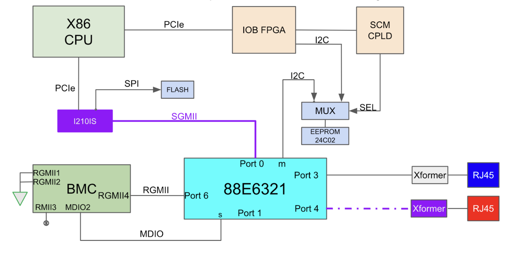

-   **Design #2 (1x1G RJ45 & 1x10G SFP+):**

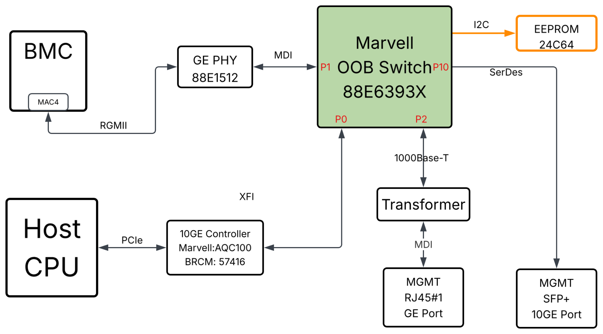

## 8.2. Serial Console Access

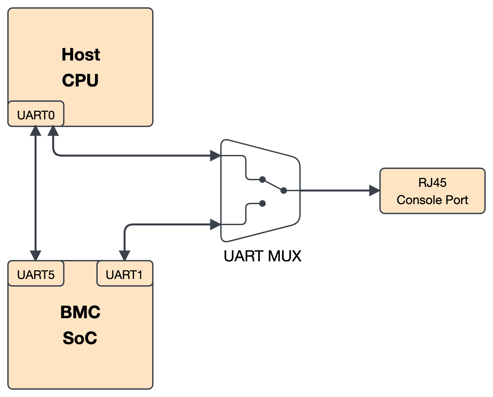

The serial console subsystem provides critical out-of-band access for low-level debugging, BIOS configuration, OS recovery, etc. The design shall adhere to the following specifications:

-   The switch must feature a front-panel RJ45 serial port, defaulting to the BMC’s primary UART controller upon power-up.
-   To enable direct BMC-to-Host communication, a dedicated BMC UART controller must link to the Host CPU’s UART controller.
-   The front-panel serial port may connect directly to the BMC or through a MUX; manufacturers should consult the customer for the preferred setup.
-   If a MUX is used, administrators must be able to switch the front-panel connection to the Host CPU’s console UART controller—the same controller that carries the direct BMC-to-Host link—either by configuring FPGA/CPLD registers from the BMC or using terminal hot keys. The Host and BMC baud rates should be the same.

## 8.3. Optical Module Access

Host-side management of optical modules is facilitated via dedicated I2C and GPIO interfaces, enabling parallel access and robust control. Below is the logical diagram for reference:

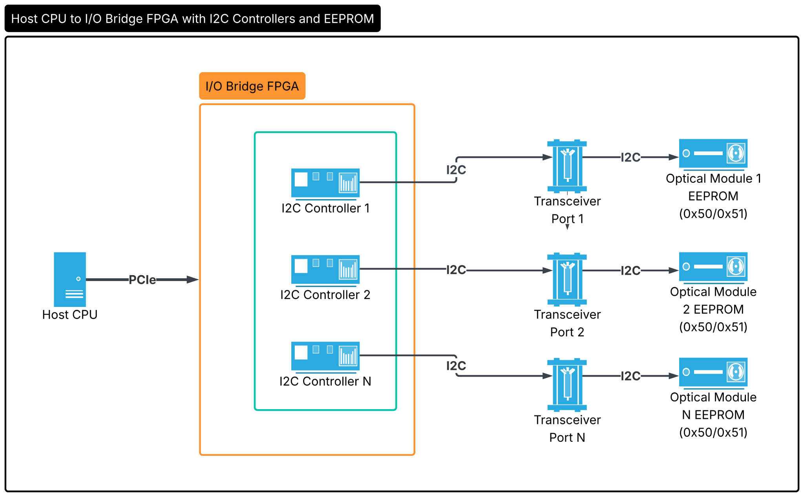

### 8.3.1. Hardware Design Guidelines

-   **I2C Connectivity:** Each optical module shall be assigned a dedicated I2C controller. The use of external or internal multiplexers is strictly prohibited to ensure full parallel access and reliable firmware upgrades. Refer to Appendix A for generic I2C design guidelines.
-   **GPIO Signals:** The hardware design must provide the following dedicated GPIO lines connected to the Host’s GPIO controller or CPLD:
    -   **Presence:** An input signal utilized for real-time hot-plug detection.
    -   **Interrupt:** An input signal dedicated to signaling events from optical modules.
    -   **Reset:** An output signal governing the module's reset state. Optics must default to an "in-reset" state upon power-up, requiring platform management software to initialize the transition out of reset.
    -   **Low Power:** An output signal managing transitions into low-power modes. By default, modules should initiate in a low-power state following a power cycle (please confirm specific requirements with the customer).
    -   **Module Select:** An output signal that must remain permanently enabled.

### 8.3.2. I2C Controller Requirements

It’s desired to incorporate the following features into the I2C controllers:

-   **Bus Recovery:** Controllers shall include a software-accessible reset bit to enable transaction aborts and recover from bus-stuck conditions.
-   **Telemetry:** Controllers should ideally feature statistics registers for tracking transaction history and error metrics, such as timeouts and NACKs.
-   **Bus Speed:** A minimum 100KHz clock frequency is required for standard operations, with FPGA designs supporting dynamic runtime clock adjustments.
-   **Optics Firmware Upgrade:** For firmware upgrades, controllers should support higher clock frequencies (e.g., 400KHz to 1MHz); manufacturers should verify the required frequency with the customer.

## 8.4. Optical Retimer Access

In modern switches utilizing high-speed optical modules, Retimers are essential to maintain signal integrity by compensating for signal degradation over long board traces. These retimers shall be managed by platform software via the MDIO bus.

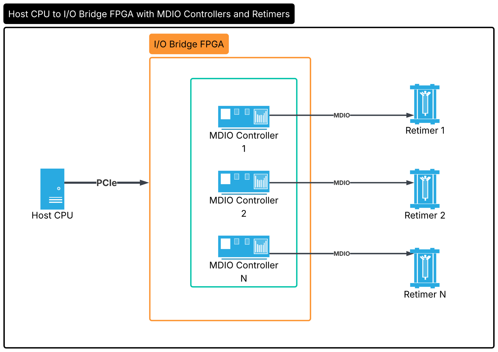

The following hardware requirements must be met for this management:

-   **MDIO Controller Mapping:** Each External PHY (XPHY) should ideally be mapped to a dedicated MDIO controller. While multiple XPHYs may share an MDIO controller, 1:1 mapping is preferred to minimize serialization latency.
-   **Controller Resilience:** Hardware must support independent resets for MDIO controllers to ensure recovery from transient bus faults.

## 8.5. Front-panel LED Management

This section details the design requirements for front-panel system LEDs, including functional definitions, color coding, blink patterns, and software driver integration.

Note:

-   The hardware-controlled Leak Status LED is defined in the “Liquid Leak Detection” section.
-   Port-specific LEDs (QSFP/OSFP/SFP) are explicitly excluded from this specification.

### 8.5.1. Requirements

-   **Required Indicators:** At minimum, the system must include the following front-panel indicators: System Status, Power Status, Fan Status (where applicable), and Leak Status (for liquid-cooled systems only).
-   **Control Interface:** The LED controller must support multi-color status, with independent, 8-bit programmable intensity (256 levels) per color channel (R, G, B).
-   **Hardware Features:** The controller must expose register interfaces for on/off state, intensity control, and blink patterns. Hardware-driven blinking is required to minimize CPU overhead.
-   **Blink Patterns:** The system shall support at least three distinct blink states: Solid (no blink), FAST (0.5s period), and SLOW (2.0s period).
-   **Software Integration:** The LED controller must interface directly with the Linux LED subsystem, exposing control via standard sysfs interfaces (/sys/class/leds) to ensure OS-level portability and diagnostic compatibility.

### 8.5.2. Operational Logic

The following table outlines the recommended LED color coding and status conditions. The proposed scheme uses Blue to indicate normal operation and Amber for alert conditions. Final requirements should be confirmed with the customer.

| **LED**           | **OFF**          | **Blue (Normal)**                  | **Amber (Alert)**                            | **Blink Patterns**                  |
|-------------------|------------------|------------------------------------|----------------------------------------------|-------------------------------------|
| **System Status** | Initial power-on | System healthy; all FRUs present.  | FRU fault, thermal event, or firmware stale. | Fast blink during firmware upgrade. |
| **Power Status**  | Initial power-on | PSUs present/functioning properly. | PSU fault, overheat, OVP, or OCP.            | N/A                                 |
| **Fan Status**    | Initial power-on | Fans present and within RPM range. | Fan missing or out-of-range RPM.             | N/A                                 |

## 8.6. USB Topology

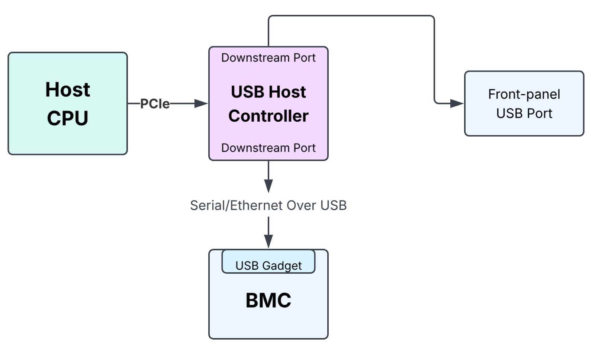

The USB topology is illustrated above; the corresponding design requirements are outlined below.

-   **Front-Panel Connectivity:** Designs must include at least one front-panel USB port compliant with the USB 2.0 standard (or higher). By default, this port must be routed to the Host subsystem's USB host controller.
-   **Inter-Subsystem Communication:** To facilitate troubleshooting and diagnostics, one of the Host USB controller's downstream ports should connect to the BMC's USB gadget controller. This configuration enables high-speed serial/ethernet over USB communication between the Host and BMC.
-   **USB Hub Management:** If system constraints necessitate the use of USB hubs, the hub’s hardware reset pin must be connected to the Host’s GPIO controller. This allows platform software to autonomously recover the hub from a 'stuck' state without requiring a power cycle.

# 9. Hardware Inventory Management

## 9.1. Concept Overview

The **Atomic Platform Entity (APE)** is defined as the atomic hardware inventory entity managed by platform software, which represents the smallest unit of hardware that can be individually tracked, inventoried, and managed. This abstraction allows for flexibility across different system architectures. APE examples include:

-   **Field Replaceable Unit (FRU):** A complete, field swappable unit, such as a Power Supply Unit (PSU) or a Fan Tray. Each field-swappable APE must include a dedicated GPIO line to enable platform software to monitor its presence status in real-time.
-   **Standalone PCBA:** An individual printed circuit board assembly that functions as a distinct management entity, such as the Switch Main Module (SMB) which contains the switching ASIC and various voltage regulars and sensors.
-   **Combined PCBAs:** This category comprises multiple PCBAs assembled as a single unit that can be represented as one logical APE, particularly when individual boards lack dedicated platform devices and are therefore 'software-transparent.' For instance, if two LED boards are assembled to the SMB board and LEDs are controlled directly by the FPGA on SMB board, the two LED boards can be grouped with the SMB into a single logical APE to simplify platform software management.

## 9.2. APE Hierarchical Topology

The Atomic Platform Entity (APE) topology must be structured as a tree. Each switch platform must designate a single APE as the root APE, with all other APEs serving as children in the hierarchy. This hierarchical tree structure is critical for platform device enumeration, enabling the system to systematically discover and map the entire hardware inventory:

-   **Parent APE (Upstream):** A Parent APE serves as a host or provider for subordinate units, such as providing outgoing I2C/SPI/MDIO buses through its physical slot connections. The Parent APE is the node from which the system enumerates its children.
-   **Child APE (Downstream):** A Child APE is a dependent unit that connects to its parent to gain accessibility. It derives its management path or resource availability through its parent.

<!-- -->

-   **Dependency Propagation:** Management traffic (e.g., I2C/SPI/MDIO) typically originates from the Root APE and flows down to the leaves.
-   **Enumeration Order:** During system initialization, the platform software must first discover and initialize the Parent APE before it can access or enumerate the attached Child APEs.

## 9.3. APE Identification (IDPROM Specification)

An IDPROM is a dedicated EEPROM used to uniquely identify an Atomic Platform Entity (APE) or the switch platform. Inclusion of an IDPROM is mandatory for any APE containing hardware components managed by platform software—such as PSUs with PMBus-compliant controllers or Switch Main Boards (SMB) containing VRMs and sensors. For APEs that lack software-managed devices, such as basic fan trays, an IDPROM is optional.

To facilitate device enumeration and management, each APE IDPROM must contain sufficient data to identify the unit, including, at a minimum, the APE type/name and its hardware revision.

### 9.3.1. Root APE IDPROM

Platform software generally treats the Host CPU's embedded I2C/SMBus as a 'global' I2C bus available to all APEs, assuming that the Host CPU’s embedded I2C/SMBus controllers are initialized automatically before platform services. For example, below are the 2 CPU embedded SMBus Controllers from Intel Icelake-D CPU:

-   SMBus iSMT adapter at 20fffa7b000
-   SMBus I801 adapter at 5000

The Root APE's IDPROM must be connected directly to the Host CPU's embedded I2C/SMBus controller. This dedicated connection is critical, as it ensures the IDPROM is initialized and readable before the system attempts to verify the Root APE's hardware revision.

### 9.3.2. Platform Identifier IDPROM

The Platform Identifier IDPROM is a special IDPROM containing the switch platform’s identification data, such as product name, serial number, asset tag, etc. The Platform Identifier IDPROM is used by platform software and system administrators to identify the switch name/type.

Below are the design requirements for the Platform Identifier IDPROM:

-   Must be placed on the PCB that is part of the chassis or switch blade; it must never be placed on components that are field-swappable.
-   Must be accessible to both the BMC and Host. It is acceptable to implement two Platform Identifier IDPROMs on the switch (one for Host, the other for BMC) with identical content to ensure safe and concurrent access.

### 9.3.3. APE IDPROM Requirements

-   **IDPROM Format:** Please coordinate with the customer to confirm the required IDPROM format. Either of the following formats is acceptable:
    -   The Meta EEPROM format, as utilized in Meta FBOSS switches: <https://facebook.github.io/fboss/docs/platform/meta_eeprom_format_v6/>
    -   The ONIE TlvInfo EEPROM format: <https://opencomputeproject.github.io/onie/design-spec/hw_requirements.html>

<!-- -->

-   **Topology:** APE IDPROMs must connect either directly to an incoming I2C bus from the parent APE or directly to the Host CPU’s SMBus Controller.
-   **Host CPU Access:**
    -   Must have direct access to the Platform Identifier IDPROM, containing essential identification data such as product name, serial number, part number, and asset tag.
    -   Must have comprehensive access to all APE IDPROMs across the system.
-   **BMC Access:**
    -   Must have direct access to the Platform Identifier IDPROM, containing essential identification data such as product name, serial number, part number, and asset tag.
    -   Must have direct access to IDPROMs containing the BMC and Host MAC addresses; the Host MAC address is necessary for configuring Host network boot from BMC.
    -   IDPROMs for the BMC subsystem must be connected directly to the BMC SoC’s I2C controllers, with no MUXes utilized.
-   **Concurrent Access:** For IDPROMs that must be accessible to both the BMC and Host (such as the Platform Identifier IDPROM), the system design must provide hardware-level support for simultaneous access. This requirement is essential to eliminate the need for software-level arbitration or synchronization protocols between the two subsystems.

## 9.4. Switch Platform Identification

The switch manufacturer shall make sure the switch product name can be fetched by running “dmidecode -s system-product-name”, and the product name shall be identical to the product name in the Platform Identifier IDPROM.

The Platform Device Discovery service fetches product name from dmidecode and loads the corresponding platform services configuration files to understand the APE topology and device settings. Please note the Platform Identifier IDPROM cannot be used in this scenario because the IDPROM's bus/address are platform specific and therefore unknown before configuration load.

## 9.5. Platform Device Enumeration

The platform software is responsible for dynamic system discovery and initialization, following the hierarchical structure defined by the APE topology. This process must occur in a deterministic order, traversing from the Root APE down to the terminal Leaf APEs.

### 9.5.1. Enumeration Methodology

-   **Hierarchical Traversal:** Discovery must proceed in a top-down manner. The system initiates enumeration at the Root APE, identifying all direct-connect Parent APEs, and recursively discovering and initializing subordinate Child APEs.
-   **Dependency Management:** Initialization must respect the topology; a Parent APE must be fully enumerated and ready before the software attempts to access or initialize its attached Child APEs.
-   **Presence Validation:** Before accessing any hot swappable APEs, the software must validate the component's state by querying the associated Presence GPIO line. Access to devices on an APE where the presence signal is de-asserted is strictly prohibited to prevent bus contention or system faults.

### 9.5.2. Dynamic Event Handling

-   **Hot-Plug Detection:** For hot swappable APEs, the platform software should implement interrupt-driven event handling or polling mechanism for insertion and removal.
-   **State Re-Evaluation:** Upon detecting a hot-plug event, the software must perform a targeted re-enumeration of the affected APE branch rather than a full system scan, minimizing the impact on the control plane.

## 9.6. Case Study: Minipack3 Device Enumeration

To illustrate the APE framework and device enumeration, we use the Meta Minipack3 switch as a practical reference. Detailed design specifications for the Minipack3 can be found here:

-   [Minipack3 Design Package](https://www.opencompute.org/documents/meta-minipack3-design-package-zip)

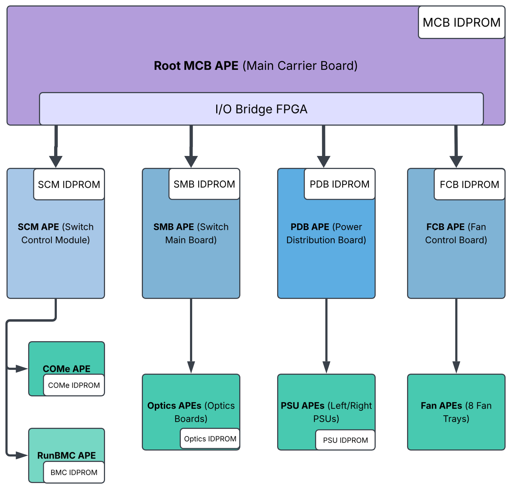

The Main Carrier Board (MCB) functions as the root APE, housing the I/O Bridge FPGA that provides I2C, SPI, MDIO, and GPIO connectivity for all other PCBAs. The Platform Device Discovery service manages enumeration and initialization through the following workflow:

1.  **Platform Configuration:** The service retrieves the switch product name via *dmidecode* to load the appropriate platform configuration file, which outlines the APE topology and settings for all hardware revisions.
2.  **Root APE Initialization:** Discovery commences at the root APE (MCB). It initializes the MCB IDPROM using information from the configuration file, leveraging the readily available Global (CPU-embedded) I2C bus.
3.  **Revision-Specific Configuration:** With the IDPROM initialized, the service identifies the board revision and applies the corresponding configuration—such as production phase (e.g., EVT, DVT, PVT) and hardware variant (e.g., component re-spin or alternate sourcing)—to match the specific hardware.
4.  **Controller Setup:** Based on the applied configuration, the service initializes the I/O Bridge FPGA’s controllers (I2C, SPI, MDIO, GPIO, LED) along with any relevant sensors or voltage regulators on the MCB.
5.  **Recursive Child Enumeration:** After the root APE is fully operational, the service recursively discovers and initializes all child APEs.
6.  **Recursive Process for Child APEs:** This standard procedure applies to every APE:
    1.  1\. Initialize the IDPROM and verify the board revision.
    2.  2\. Load the configuration entry matching the revision and initialize associated devices.
    3.  3\. Proceed to traverse and initialize the next level of child APEs.

# 10. Environment Monitoring and Control

## 10.1. Hardware Sensors Monitoring

Modern network switches utilize a vast array of hardware sensors to monitor/manage voltage rails, current draw, power metrics, and thermal conditions throughout the system. These sensors serve several critical functions, such as temperature monitoring, power budgeting, fault detection, telemetry and alert.

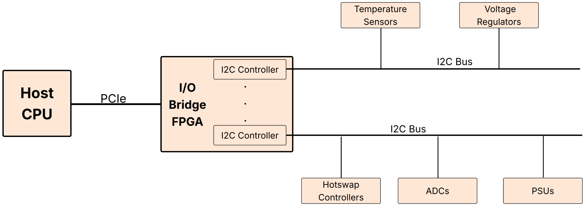

The above diagram details the reference architecture for I2C sensor connectivity. In this design, the Host CPU interfaces with the "I/O Bridge FPGA" via the PCIe bus. This FPGA facilitates multiple I2C controllers that link to a variety of hardware monitoring components, including PSUs, multi-rail ADCs, hotswap controllers, voltage regulators, and temperature sensors.

### 10.1.1. Sensor Design Guidelines

All I2C sensor designs must strictly comply with the requirements detailed in "Appendix A: I2C Design Best Practices." In addition to those requirements, the following guidelines apply specifically to hardware sensor design:

-   **Strategic Sensor Placement:** Temperature sensors must be placed in immediate proximity to critical heat sources (e.g., ASIC die, hot-pluggable optics, voltage regulators) to ensure accurate thermal tracking. Layouts must incorporate physical barriers or thermal vias to prevent localized heat sources from causing thermal crosstalk or false readings in adjacent sensors.
-   **Interrupt-Driven Telemetry:** Implementations should prioritize interrupt-driven alerts (e.g., the SMBus ALERT# pin) over continuous polling. This reduces unnecessary bus traffic, lowers CPU overhead, and enables immediate response to critical thermal or electrical thresholds.
-   **Standard Linux Driver Support:** To minimize software development effort and ensure long-term maintainability, designs must prioritize sensor chips with existing upstream Linux driver support. Utilizing mainlined drivers ensures seamless integration, standardizes telemetry access, and facilitates compatibility with kernel-level diagnostic tools.
-   **Signal Integrity and Protection:** For sensors located on remote or cable-connected subsystems (e.g., fan trays, PSU backplanes), the design must include robust ESD protection and signal level shifters. These measures are essential to maintain bus integrity across long trace lengths or connector interfaces, preventing noise-induced data corruption.
-   **Sensor Accuracy:** Precision requirements depend on the specific sensor type and switch platform; please consult the customer to verify exact specifications.

## 10.2. Thermal Management

The following specifications outline requirements for air-cooled, liquid-cooled, and hybrid-cooled systems. The hybrid-cooled model utilizes liquid cooling for thermally sensitive components while employing air cooling for the remaining parts of the system.

### 10.2.1. Fan Management

-   **Boot-time Thermal Governance:**
    -   Upon a switch-level power cycle, all system fans, excluding PSU fans, must autonomously default to a platform-validated safe PWM duty cycle, or to a sufficient fan speed to maintain system cooling when the ASIC is out of reset, to ensure thermal health without relying on the thermal management service.
    -   Operational fan speed adjustment is subsequently managed by a thermal management service based on system requirements.
-   **Fan Interface and Telemetry (PWM and RPM):**
    -   All system fans, excluding PSU fans, shall be accessible via a controller chip featuring upstream Linux *hwmon* support.
    -   The *hwmon* interface must facilitate Pulse Width Modulation (PWM) for speed control and provide real-time Fan RPM telemetry.
-   **Fan Watchdog Implementation:**
    -   To ensure proactive thermal protection, the system shall implement a fan watchdog mechanism.
    -   The watchdog must be disabled by default following a switch-level power cycle.
    -   The fan watchdog hardware shall provide register interfaces to allow for the customization of timeout values, ensuring compatibility with upstream Linux watchdog drivers.
    -   During normal operation, the thermal management service shall periodically 'kick' the watchdog to indicate system health.
    -   Upon watchdog expiration, the system shall autonomously set all system fans, excluding PSU fans, to a platform-validated safe PWM duty cycle sufficient to maintain thermal limits under the system’s maximum supported operating load.
    -   Following a timeout, the watchdog must remain in an 'expired' state. It shall provide a mechanism for software to clear this state and reset the watchdog, thereby resuming normal operational monitoring.
-   **Presence and Alerting Validation:**
    -   **Presence Detection:** Each hot-swappable fan module must include a dedicated Presence GPIO line, routed through the system FPGA or CPLD. This signal shall be accessible to platform software, allowing for real-time monitoring of module insertion and removal events.
    -   **LED Status Signaling:** Every fan module must support visual status indication via dedicated LEDs. LED control logic must interface with the standard Linux LED subsystem (/sys/class/leds) to allow platform management services to drive status indicators based on real-time telemetry and error states.

### 10.2.2. ASIC Overheat Protection

Although modern switch ASICs frequently include integrated thermal protections—such as performance throttling or emergency shutdowns—these safeguards may be inadequate in certain failure modes. For instance, if a coolant flow failure occurs, an overheated ASIC might enter a reset state yet remain powered, continuing to draw substantial current. This sustained power consumption can overwhelm cooling systems, potentially leading to permanent hardware damage.

To ensure robust thermal protection, this architecture incorporates an independent external monitoring circuit that continuously tracks ASIC temperature and autonomously triggers a voltage regulator shutdown if thermal limits are exceeded.

**Reference Design:**

ASIC temperature reporting mechanisms vary across architectures, with some utilizing clock pin sampling while others rely on on-die thermal diodes. This reference design focuses on architectures using on-die thermal diodes. The core strategy leverages the temperature sensor’s alert or interrupt output to directly drive the enable pin of the ASIC’s voltage regulator, ensuring an autonomous power-off sequence during thermal fault conditions. To enhance flexibility and observability, a CPLD is positioned between the temperature sensor and the voltage regulator. The process is as follows:

-   **Thermal Monitoring:** The ASIC's integrated thermal diode interfaces with an external temperature sensor (e.g., MAX6581) for continuous, real-time core temperature monitoring.
-   **Threshold Configuration:** The system must implement hardware/CPLD default thresholds effective at power-on, with provisions for software to adjust thermal limits via the I2C/SMBus interface.
-   **Autonomous Power-Off Sequence:** Sensor alert signals are routed to a CPLD, which acts as the central control logic. Upon detecting an over-temperature condition, the CPLD automatically de-asserts the voltage regulator's Enable (EN) pin to force an immediate ASIC power-down. This design permits customizable shutdown logic without requiring physical hardware modifications.
-   **Shutdown Latching:** The CPLD must latch the shutdown state; the system must only release this state via an explicit software write or a full power cycle, ensuring that ALERT de-assertion does not inadvertently restore power.
-   **Diagnostic Observability:** To facilitate root-cause analysis, any over-temperature event is captured by a "sticky bit" within the CPLD or DPM, providing a persistent record. This bit remains set until explicitly cleared by a write command or a full system power cycle.

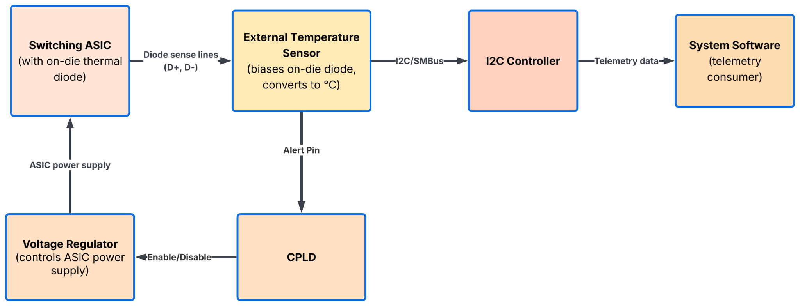

## 10.3. Liquid Leak Detection

The integration of liquid cooling requires a robust, autonomous architecture for leak detection and mitigation. As leak detection capabilities are highly dependent on datacenter facility infrastructure, switch manufacturers should consult with customers to determine specific requirements.

The following guidelines outline the best practices for leak detection systems:

-   **Design Independence and Autonomy:**
    -   The leak detection circuit must be hardware-resilient, maintaining full functionality even if the Host CPU or BMC becomes unresponsive. This decoupling ensures that safety mechanisms remain active during system hangs or firmware failures.
-   **Emergency Shutdown Logic (Leakage Response):**
    -   **Host Shutdown:** Detection of a major liquid leak must trigger an immediate and autonomous shutdown of the Host subsystem (CPU, ASICs, Optics) to eliminate electrical hazard risks.
    -   **BMC Operational State:** The BMC must remain powered via the Auxiliary Power Domain during a leak event. In this state, the BMC logs the incident, and ensures telemetry is captured for post-mortem analysis.
-   **Hardware and Mechanical Best Practices:**
    -   **Containment:** Mechanical design shall incorporate localized liquid containment, such as drip pans or trays, to prevent coolant migration beyond the affected module.
    -   **Sensor Granularity:** Detection sensors (e.g., wire ropes or spot sensors) must be implemented at the component, tray, and rack levels, featuring adjustable sensitivity to distinguish between minor condensation and catastrophic leaks.
    -   **Verification Mechanisms:** The design must include an integrated "leak injection" mechanism to emulate leak events, facilitating the verification of the detection circuit integrity and end-to-end shutdown software responsiveness.
    -   **Telemetry and Integrity:** Leak detection logic must interface with the BMC or local CPLD to raise management alerts. The BMC shall periodically verify the integrity of the leak detection circuit to ensure the system is capable of sensing events at all times.
    -   **Leak Status LED**: The leak status LED must be implemented via hardware control to ensure autonomous indication.
-   **Rack Integration:**
    -   Consult the customer to define detailed rack integration requirements, including coordination between the switch blade and the rack-level management controller (if applicable).

# 11. Firmware Maintenance and Recovery

## 11.1. Firmware Upgrade Basic Requirements

Reliable firmware update mechanisms are essential for the maintenance and lifecycle management of field-programmable devices, including BIOS, FPGAs, CPLDs, PSUs, and configuration EEPROMs (e.g., for OOB switches). The following design requirements and best practices shall be adhered to:

-   **SPI Flash Preference:** Where feasible, designs must prioritize SPI flash memory for firmware storage. This interface enables the use of robust, standard Linux utilities like *flashrom* and *flashcp*, streamlining the software stack and simplifying firmware lifecycle management.
-   **Avoidance of JTAG for Updates:** JTAG is not a preferred interface for field firmware upgrades. There is no standard Linux ABI for JTAG access from user space, which necessitates vendor-specific, non-portable software implementations and complicates production-level maintenance.
-   **Avoidance of I2C for Firmware Updates:** - Avoid using I2C as the primary method for firmware updates, except where mandated by device standards (e.g., PMBus PSUs, CMIS/SFF optics, small configuration EEPROMs). I2C's limited bandwidth and slow transfer speeds make it unsuitable for most firmware upgrades, as these factors increase the risk of corruption and update failure.

## 11.2. Firmware Recovery

Hardware design must ensure system resilience against firmware corruption caused by sudden power loss, system crashes, or incomplete update cycles. The following best practices and requirements are mandatory for robust firmware recovery:

-   **A/B Bank Redundancy:** Critical firmware must implement A/B bank switching or equivalent redundancy to prevent system bricking, ensuring a validated, fallback-ready image remains accessible if the primary bank is corrupted.
-   **Dual-Path Recovery:** Critical firmware shall support multiple update paths, ensuring recoverability even if the primary "golden" bank fallback fails.
-   **Primary Firmware Update Path:** The Host subsystem serves as the primary update authority. BMC-based firmware recovery is reserved for fail-safe or emergency recovery scenarios.
-   **Host Recovery Mechanism:** To mitigate catastrophic Host boot failure (e.g., UEFI/BIOS corruption), the BMC must retain direct hardware access to flash storage (via SPI bus switching or similar interfaces). This ensures the BMC can force recovery or re-flash the firmware regardless of the Host’s operational state.

## 11.3. Case Study: Minipack3 Firmware Upgrade Strategy

The diagram below outlines the firmware upgrade strategy for the Meta Minipack3 switch. By leveraging SPI flash access, major firmware components can be updated using the standard Linux "flashrom" utility, facilitating rapid enablement during initial board bring-up. Critical firmware—specifically the IOB FPGA and UEFI/BIOS images—requires an independent BMC-based recovery path to ensure system resilience.

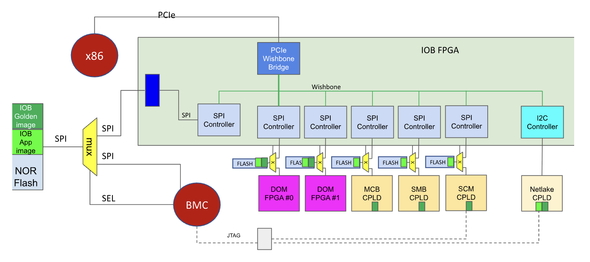

# 12. Security

Comprehensive security specifications will be defined in subsequent revisions of this document.

# 13. Debuggability

To ensure rapid fault isolation, efficient root-cause analysis, and robust system recovery, the switch architecture must prioritize standardized observability and redundant debug interfaces.

## 13.1. IPMI

The platform must implement robust IPMI support, utilizing eSPI or I2C/IPMB as the primary communication channels. These interfaces facilitate critical diagnostic capabilities—specifically System Event Logs (SEL) and Power-On Self-Test (POST) code reporting—which are essential for isolating Host CPU failures and diagnosing system boot stalls.

System requirements include:

-   **SEL Reporting:** All Host subsystem failures—such as fatal processor, memory (DIMM), PCIe, and interconnect errors—must be reported to the BMC via SEL. Ensure SEL timestamps are synchronized via NTP to enable precise event sequencing during post-mortem analysis.
-   **POST Code Access:** The hardware design must ensure reliable capture of Host CPU POST codes by the BMC. This enables the BMC to track boot progress and identify the exact stage of any boot stall.
-   **Decoupling:** Host BIOS/OS boot must not depend on BMC IPMI service availability. The Host subsystem shall remain capable of independent boot and recovery even if the BMC's primary message-processing engine is unavailable.

## 13.2. Processor & System Error Reporting

Critical processor error signals must be routed to BMC-accessible CPLD or FPGA inputs, such as CATERR# (Catastrophic Error) and ERR\[2:0\]# (the error-severity–encoded signals, e.g. correctable / uncorrectable-recoverable / fatal) for Intel CPUs, and FATAL_ERROR_L (asserted on a fatal/uncorrectable error, functionally analogous to CATERR#) and APML_ALERT_L (the APML sideband alert line) for AMD CPUs, etc. This routing enables the BMC to perform immediate, interrupt-driven logging and capture the CPU's architectural state upon a fatal failure.

The Platform Environment Control Interface (PECI) for Intel CPUs or Advanced Platform Management Link (APML) for AMD CPUs shall be implemented to facilitate high-fidelity out-of-band debugging and telemetry capture.

## 13.3. Hardware Fault Logger

To facilitate robust post-mortem analysis, it’s desired to implement a dedicated non-volatile memory region—such as flash or EEPROM—to capture the system's 'last-will' state, including critical register dumps, error signatures, timestamp, etc. This capture process must be hardware-orchestrated to occur prior to any system reset, bypassing the need for software intervention to guarantee data persistence across power cycles.

Please coordinate specific implementation requirements with the customer.

# 14. Host Software Reference Design

The Host software architecture follows the "In-Host" management model, leveraging the Host's computational resources to manage platform devices.

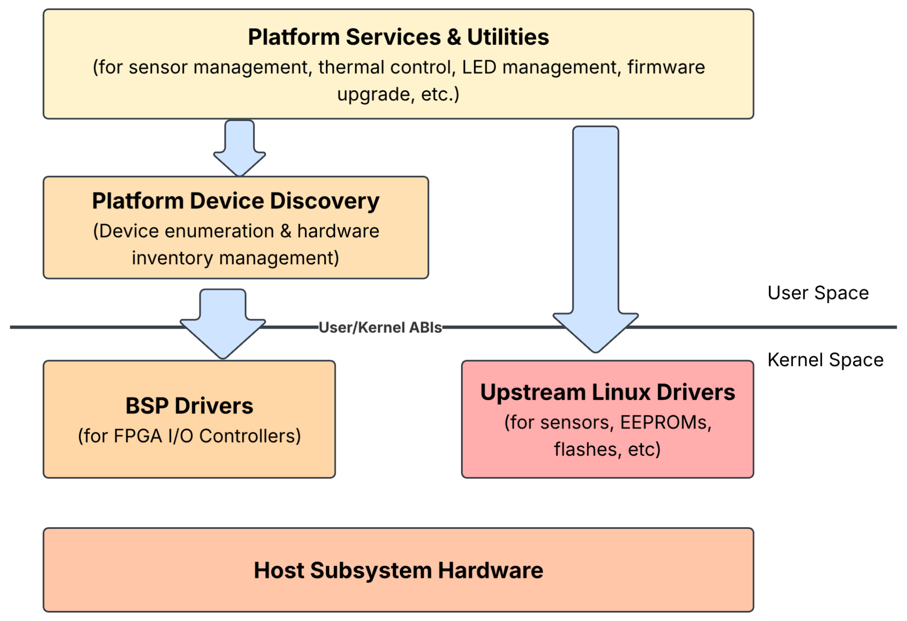

The software stack is organized into three distinct layers to ensure modularity, scalability, and ease of maintenance:

1.  **Device Driver Layer:** This layer encompasses two distinct sets of drivers: the I/O Bridge (IOB) FPGA controller drivers (such as I2C/GPIO/MDIO/SPI controller drivers that are not upstreamed to Linux kernel yet), and standard upstream Linux drivers used to manage the various client devices—such as sensors, EEPROMs, and flash memory that are attached to the switch.
2.  **Platform Device Discovery Layer:** This layer handles dynamic system discovery and initialization based on the hierarchical Atomic Platform Entity (APE) topology.
3.  **Platform Services and Utilities:** This layer hosts high-level management services, such as sensor telemetry, thermal control, LED management, and firmware maintenance.

A key benefit of this standard Switch Platform Architecture is that onboarding a new switch platform requires only a new configuration file that describes the APE topology and device settings. Once this configuration is loaded, all services are automatically initialized and function correctly, significantly accelerating development and platform onboarding.

## 14.1. Device Driver Design

The I/O Bridge (IOB) FPGA is a physical PCIe device containing numerous IP blocks, such as I2C, SPI, MDIO, GPIO, and LED controllers. Our driver architecture utilizes a PCIe Umbrella driver to probe the FPGA and leverages the Linux Auxiliary bus to manage these I/O controllers (IP blocks).

Compared to the traditional Linux MFD (Multi-Function Device) framework, the Linux Auxiliary bus provides a more flexible and decoupled architecture and simplifies driver lifecycle management for each I/O controller.

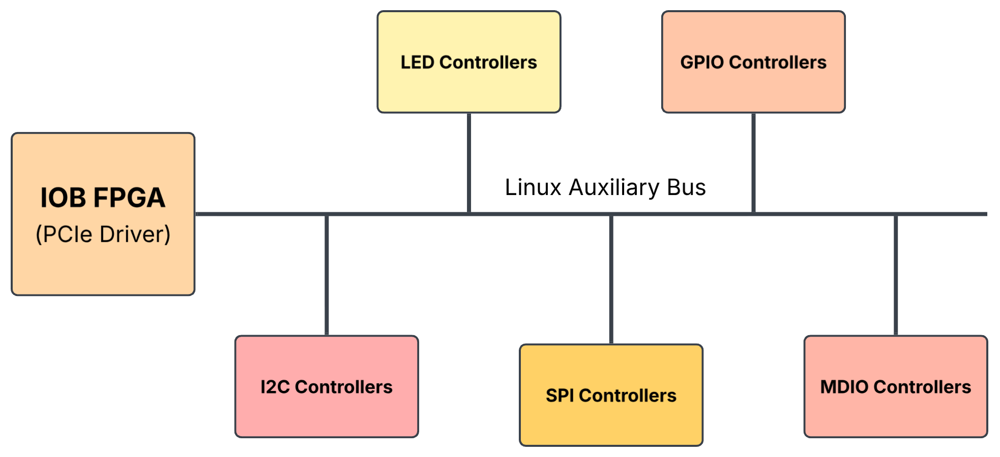

### 14.1.1. FPGA I/O Controller Discovery

The FPGA PCIe Umbrella driver requires a specific set of configuration parameters to enumerate I/O controllers, including I/O controller type, register offsets, controller counts, bus frequency, and client device settings (e.g., for SPI). These parameters can be provided to the driver using one of the following methods:

1.  **ACPI Table:** I/O controller configurations are embedded directly within the ACPI tables, facilitating standard, ACPI-compliant device discovery.
2.  **FPGA Memory-Mapped Space:** Configuration data is stored in a dedicated, self-describing memory region accessible via the FPGA's memory-mapped space.
3.  **Userspace Interface:** I/O controller configurations are passed from userspace to the IOB FPGA PCIe (Umbrella) driver using sysfs or ioctl interfaces, allowing the driver to dynamically handle I/O controller creation.
4.  **Device Tree Interface:** I/O controller configurations are described in Device Tree nodes, and the OS kernel dynamically instantiates the devices based on the Device Tree description.

The Userspace Interface (#3) is preferred in the document, as it offers superior flexibility by allowing dynamic adjustments to device settings from userspace. This approach avoids the need for ACPI table modifications or FPGA firmware updates, thereby preventing service interruptions. The proposed ioctl interfaces for managing FPGA I/O controller creation and deletion from userspace are defined in the following header file:

-   <https://github.com/facebookincubator/fboss.bsp.kmods/blob/main/kmods/lib/fbiob-ioctl.h>

### 14.1.2. IOB FPGA Driver Example

The repository linked below provides the I/O Bridge FPGA drivers currently deployed across over 10 FBOSS platforms. While certain CPLD drivers remain platform-specific, the IOB I2C, SPI, GPIO, and MDIO controller drivers are unified and identical across all supported platforms.

-   <https://github.com/facebookincubator/fboss.bsp.kmods/tree/main/kmods>

### 14.1.3. User/Kernel ABI

Platform software interacts with the hardware through standard Linux kernel ABIs, ensuring compatibility with common diagnostic and management tools. The following interfaces are utilized:

-   **I2C:** Bus-level communication is managed via /dev/i2c-\* character devices. See [I2C User-space Interface](https://www.kernel.org/doc/html/latest/i2c/dev-interface.html).
-   **GPIO:** General purpose I/O is managed via sysfs or the libgpiod library. See [GPIO Guide](https://www.kernel.org/doc/html/latest/admin-guide/gpio/gpio-legacy.html).
-   **HWMON:** Environmental telemetry (temperature, voltage, current) is exposed via the /sys/class/hwmon/ directory. See [HWMON Documentation](https://www.kernel.org/doc/html/latest/hwmon/index.html).
-   **EEPROM:** Read and write access is typically provided through sysfs interfaces on the corresponding I2C device node.
-   **LEDs:** LED status and control are managed through the /sys/class/leds/ interface. See [LEDs Class Documentation](https://www.kernel.org/doc/html/latest/leds/leds-class.html).

## 14.2. Platform Device Discovery

The PlatformDeviceDiscovery service orchestrates system discovery and initialization, utilizing a configuration-driven approach to abstract hardware variations from core management logic. It relies on a platform-specific configuration file (e.g., *platform_device.json*) to define the complete APE topology, encompassing I/O Bridge (IOB) FPGA register maps and client device settings.

The initialization process follows this deterministic sequence:

1.  **Platform Identification:** The service retrieves the system name via *dmidecode* to load the platform-specific device configuration file.
2.  **APE Topology Construction:** It builds a hierarchical inventory of Atomic Platform Entities (APEs) according to the defined topology.
3.  **Device Enumeration:** Starting from the Root APE, the service traverses the hierarchy, reading each APE's IDPROM to verify board revisions and initializing the corresponding I/O controllers and client devices.
4.  **Stable Mapping Creation:** To avoid reliance on dynamic Linux device indices, the service generates stable symbolic links (e.g., */run/devmap/xcvrs/xcvr_io_1* -> */dev/i2c-15*). These links ensure consistent access for platform services managing resources like optical transceivers, sensors and fans.

**Reference Code:**

-   <https://github.com/facebook/fboss/tree/main/fboss/platform/platform_manager>

## 14.3. Platform Services Implementation Principles

Platform services—including sensor monitoring, fan control, and firmware upgrade utilities—are architected to be hardware-agnostic, enabling seamless portability across different switch platforms. The implementation adheres to the following core principles:

-   **Stable Device References:** To decouple management logic from dynamically assigned kernel device paths (e.g., /dev/i2c-\* or /sys/class/hwmon/hwmon\*), all services shall reference devices using stable symlinks created by the PlatformDeviceDiscovery service.
-   **Standardized I/O Interfaces:** All platform services must interact with hardware through standard Linux User/Kernel ABIs. This approach leverages the native Linux driver ecosystem, using interfaces such as sysfs for GPIO and LED control, hwmon for environmental telemetry, and ioctl for low-level bus management. By relying on these standard ABIs, the platform services ensure compatibility with mainstream diagnostic tools and facilitate a clean, maintainable software stack that does not require platform-specific modifications.

**Reference Code:**

-   <https://github.com/facebook/fboss/tree/main/fboss/platform>

# Appendix A: I2C Design Best Practices

Robust I2C bus design is critical for system stability, signal integrity, and effective maintenance. The following best practices shall be adhered to for all I2C topologies:

-   **Avoid Multi-Master Topologies:** Multi-master I2C environments should be avoided whenever possible. A single-master topology is mandatory to minimize complexity in I2C driver design, simplify failure analysis, and ensure predictable bus behavior.
-   **Controller Reset:** Expose a reset register interface for the entire I2C controller and bus, enabling autonomous recovery from "stuck-at-low" fault conditions.
-   **I2C Controller Alignment:** I2C controller hardware design must align with the Linux I2C controller subsystem.
-   **Limit Multiplexer Depth:** The use of multiple layers of I2C multiplexers introduces unnecessary complexity and potential points of failure. The design must restrict I2C multiplexer usage to a single level.
-   **Avoid Multiple I2C Muxes per Bus:** Avoid placing multiple I2C multiplexers on the same I2C bus. Use multiple I2C controllers if possible, as sharing a bus with multiple muxes can potentially lead to address conflicts when channels are selected on multiple MUXes simultaneously.
-   **Independent Multiplexer Reset:** All I2C multiplexers must be independently resettable via CPLD or FPGA. This capability is mandatory to isolate and recover the bus if a downstream device pulls the SCL or SDA lines low.
-   **Clock Frequency Standardization:** To ensure interoperability, I2C controllers must support adjustable clock frequencies, with 100KHz established as the default baseline unless specific device requirements dictate otherwise.
-   **I2C Client Device Selection:** The selection of I2C client devices must prioritize components with existing upstream Linux driver support. Using devices with mainlined drivers reduces the engineering effort required for platform enablement and ensures long-term maintainability through standard kernel updates.
-   **Electrical Specification Compliance:** Select devices that adhere to SMBus electrical specifications—particularly regarding current sink capabilities—to ensure interoperability with standard I2C bus pull-up configurations.
-   **Implement Isolated Buffers:** For sensitive I2C devices or components not intended for regular access during normal system operations, the use of isolated buffers is required. This effectively isolates these devices from the main bus, preventing bus contention or interference from propagating during standard operation.

# Appendix B: SPI Design Best Practices

Robust SPI bus design is essential for maintaining signal integrity and system reliability, particularly at higher clock frequencies. The following best practices shall be adhered to for all SPI topologies:

-   **Minimize Chip Select Complexity:** Avoid cascading decoders or complex logic for Chip Select (CS) generation. Direct mapping of CS signals from the controller to the peripheral is strongly preferred to reduce signal propagation delay, timing skew, and complexity during debugging.
-   **Prioritize Point-to-Point Topologies:** Where possible, design for point-to-point connections rather than shared SPI buses. Shared buses increase capacitive loading and potential for bus contention, which can compromise signal integrity at higher frequencies.
-   **Standardize Clock Phase and Polarity:** To ensure platform consistency and simplified driver development, standard SPI modes (e.g., Mode 0) should be adopted as the default configuration for all peripherals, unless device-specific requirements dictate otherwise.
-   **Leverage Standard Drivers:** Prioritize components supported by upstream Linux SPI drivers. This ensures compatibility with the standard kernel infrastructure and simplifies platform enablement and maintenance.

# Appendix C: I/O Bridge FPGA Best Practices

The I/O Bridge (IOB) FPGA serves as the critical aggregation point for platform management. It encapsulates a collection of I/O controllers (e.g., I2C, SPI, GPIO, MDIO) that allow the Host CPU to manage essential platform devices such as sensors, EEPROMs, fans, CPLDs, and flashes. Design principles for this component are summarized below:

-   **PCIe Connectivity:** The IOB must connect to the Host CPU via PCIe. This interface is mandated to support high-speed data transfer and allows for memory-mapped software access, which significantly simplifies driver development compared to low-speed buses.
-   **State Retention:** The IOB FPGA must ensure that I/O controller output states—such as optics reset/LPMode, LED states, and GPIO output levels—are retained across Host CPU and PCIe link resets. These states must only be cleared by a switch-level power cycle or an explicit software request.
-   **Dedicated I/O Space:** Each I/O controller IP block within the IOB must be assigned a dedicated, non-overlapping memory/register space. This structure ensures that individual drivers can operate independently without conflict, facilitating robust and modular software management.

<!-- -->

-   **Independent Reset:** Whenever possible, IP blocks should be designed to support independent resets, ensuring that a fault in one controller (e.g., a locked I2C bus) does not impact the availability of other platform management functions.
-   **Interrupt Handling:** It’s desired to implement consistent interrupt signaling across all internal IP blocks. The top-level FPGA driver should provide efficient interrupt demultiplexing to the corresponding child drivers.
-   **Auxiliary Bus Integration:** The FPGA driver must utilize the Linux auxiliary bus framework to manage internal IP blocks, providing a standardized, modular structure for resource allocation and device lifecycle management.

# Appendix D: Customer Consultation Checklist

Below table summarizes all the areas that need further clarification from customers:

| **Item** | **Description**                                              | **Reference Section**                     |
|----------|--------------------------------------------------------------|-------------------------------------------|
| 1        | Power Supply Unit (PSU) Input Specifications (AC/DC/Voltage) | Power Supply Module                       |
| 2        | Front-Panel OOB Ethernet Port Configuration                  | Out-of-band Ethernet Access               |
| 3        | Front-Panel Serial Port Multiplexing                         | Serial Console Access                     |
| 4        | Optics Initial Power-On State                                | Optical Module Access                     |
| 5        | Optics Firmware Upgrade I2C Bus Speed                        | Optical Module Access                     |
| 6        | Front-Panel LED Operational Logic                            | Front-panel LED Management                |
| 7        | IDPROM Data Format                                           | APE Identification (IDPROM Specification) |
| 8        | Hardware Monitoring Sensor Accuracy                          | Hardware Sensors Monitoring               |
| 9        | Liquid Leak Detection Architecture                           | Liquid Leak Detection                     |
| 10       | Hardware Fault Logger Implementation                         | Hardware Fault Logger                     |

# Appendix E: Glossary

-   **ACPI (Advanced Configuration and Power Interface):** A standard for device configuration and power management.
-   **APE (Atomic Platform Entity):** The smallest unit of hardware trackable and manageable by platform software.
-   **ASIC (Application-Specific Integrated Circuit):** The primary switching chip responsible for data plane traffic.
-   **BMC (Baseboard Management Controller):** The independent, always-on subsystem responsible for system supervision, power sequencing, and fail-safe recovery.
-   **CPLD (Complex Programmable Logic Device):** A hardware component used for glue logic, reset management, and I/O control.
-   **DPM (Digital Power Manager):** A programmable power-management device used for power sequencing, monitoring, and fault recording.
-   **GPIO (General Purpose Input/Output):** Generic pins on an integrated circuit whose behavior is controllable by software.
-   **FPGA (Field Programmable Gate Array):** An integrated circuit designed to be configured after manufacturing; used here as an I/O Bridge (IOB).
-   **FRU (Field Replaceable Unit):** A hardware module designed for easy removal and replacement by technicians.
-   **Host:** The primary computational subsystem comprising the CPU and switching ASICs.
-   **IDPROM:** A dedicated EEPROM containing unit identification data (serial number, part number, etc.) for an Atomic Platform Entity.
-   **I2C (Inter-Integrated Circuit):** A synchronous, multi-master, multi-slave, packet-switched, single-ended, serial communication bus.
-   **IOB (I/O Bridge):** An FPGA acting as the aggregation and translation layer between the Host CPU and platform peripherals.
-   **IPMI (Intelligent Platform Management Interface):** A standardized message-based interface used for communication between the BMC and Host.
-   **MDIO (Management Data Input/Output):** A serial bus protocol used to manage PHYs and other network-related hardware.
-   **MUX (Multiplexer):** A device that selects between multiple inputs or outputs to route signals to a single path.
-   **OOB (Out-of-Band):** Management connectivity that is independent of the primary data network.
-   **NTP (Network Time Protocol):** A protocol for clock synchronization between computer systems.
-   **PCIe (Peripheral Component Interconnect Express):** A high-speed serial computer expansion bus standard.
-   **PMBus (Power Management Bus):** A protocol used for power supply unit (PSU) communication and telemetry.
-   **PWM (Pulse Width Modulation):** A technique used for controlling power delivery and fan speeds.
-   **UART (Universal Asynchronous Receiver-Transmitter):** A hardware device for asynchronous serial communication.
-   **USB (Universal Serial Bus):** A standard for short-distance digital data communications.
-   **SPI (Serial Peripheral Interface):** A synchronous serial communication interface used for short-distance communication, primarily in embedded systems.
-   **SEL (System Event Log):** A standardized, non-volatile log utilized by IPMI to record critical platform events.
-   **VRM (Voltage Regulator Module):** A component that provides the appropriate supply voltage to a microprocessor or ASIC.
-   **XPHY (External PHY):** An external physical layer transceiver used for high-speed network communication.
